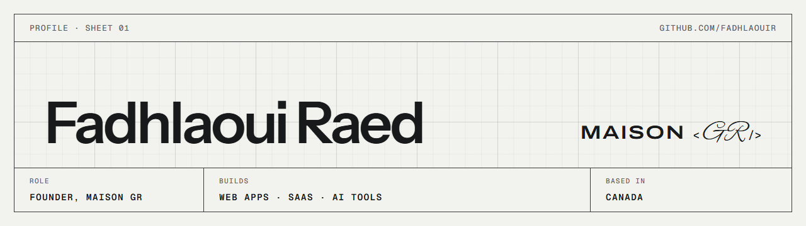

<picture>
  <source media="(prefers-color-scheme: dark)" srcset="assets/header-dark.png">
  
</picture>

I'm Raed, founder of [Maison GR](https://www.maisongr.com), a software studio. We build our own products, and we build our clients' with the same care: web apps, SaaS and AI tools that are clear, fast and easy to live with.

## Open source

| Project | What it is |
|---|---|
| [**maisongr-ai-engineering-skills**](https://github.com/maison-gr/maisongr-ai-engineering-skills) | One engineering standard for every AI coding agent: seven principles, ten skills, and receipts that check what an agent claims it verified. `npx maisongr-skills` |
| [**create-express-node-starter**](https://github.com/fadhlaouir/create-express-node-starter) | A secure Express 5 and MongoDB REST API in one command: authentication, uploads, API docs, tests, Docker and CI, with every template tested as you get it. `npx create-express-node-starter` |
| [**express-node-starter**](https://github.com/fadhlaouir/express-node-starter) | The Express 5 starter behind it: JWT, roles, email confirmation, password reset and 30 integration tests that need no database |
| [**mern-workshop**](https://github.com/fadhlaouir/mern-workshop) | Web development basics, taught for International Women's Day at ISET Nabeul and ISET Kairouan |

## Contributing upstream

In my free time I send fixes to the open-source tools I build with: IBM, Meta, Google and others. Each one is reproduced, covered by a test, and kept to a single focused change.

**[See every contribution and where it stands →](CONTRIBUTIONS.md)**

## How I work

Understand the problem before writing code. Keep each change small enough to review. Prove it works, and say plainly what was not checked.

## Contact

[maisongr.com](https://www.maisongr.com) · [LinkedIn](https://www.linkedin.com/in/fadhlaouiraed/) · [Medium](https://medium.com/@fadhlaouiraed/)
